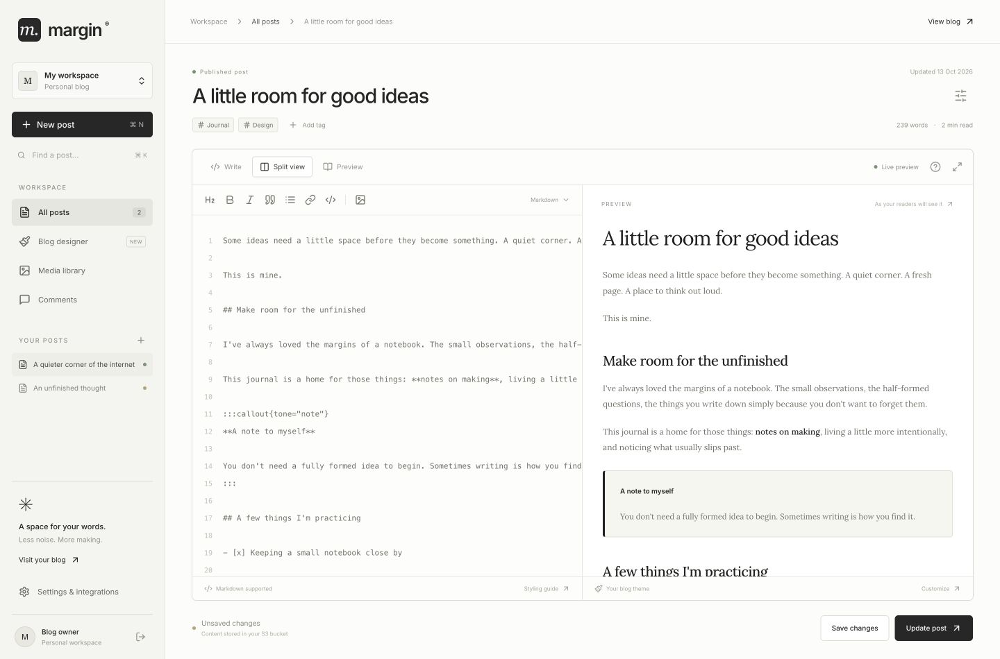

# Margin

**A lightweight home for research, engineering, and thoughts worth keeping.**

Margin is a self-hosted publishing system for articles, research notes, and guides. Write in Markdown, bring your sources and visuals, and publish on your own domain.



## Features

- **Writing and publishing.** Articles and guides, live preview, drafts, local recovery, revision history, conflict review, and configurable tables of contents.
- **Research and citations.** Website references, PDF uploads, quoted passages, and links to highlighted evidence.
- **Technical content.** Syntax-highlighted code, interactive charts, Mermaid diagrams, illustrations, 3D scenes, tabs, and callouts.
- **Media.** Drag-and-drop images, image, video and audio libraries, voice blogs, Spotify and SoundCloud players, link preview cards, video embeds, optional Cloudinary integration, and social post cards.
- **Publication design.** Themes, page templates, custom layouts, featured articles, colors, typography, logos, and desktop/mobile previews.
- **Author profile.** Manage your name, optional photo, bio, website, and social links in **Profile**, with a separate account section for email verification and password recovery. Every post and guide uses this byline; leave the image empty for name-only attribution, or leave the name empty to hide it.
- **Reader conversations.** Google or email sign-in, comments, passage questions, author replies, moderation, and private notes for subscribers.
- **Subscribers and email.** Newsletter signups, subscriber management, and email delivery through custom SMTP or the optional managed service.
- **Discovery.** Full-content search with typo tolerance, tags, related articles, publication and article SEO, social sharing metadata, and RSS.
- **Reading and sharing.** Markdown downloads, a print/PDF view, and an installable app with your publication’s branding.
- **Privacy-respecting analytics.** Traffic, reading engagement, scroll depth, clicks, highlighted passages, and content performance without tracking cookies or storing visitor IP addresses in analytics. Optional local country lookup records a country code, then discards the IP from analytics.
- **Optional AI.** Writing ideas, outlines, saved insights, formatting proposals for approval, image generation, social drafts, and smart recommendations.
- **APIs and agents.** A REST API, native MCP server, and CLI, with OAuth owner consent, selectable app permissions, and revision checks to protect concurrent edits.

## Small to run. Yours to keep.

Margin runs as a Go binary with the frontend included; no Node.js runtime is needed. Use SQLite or PostgreSQL, with encrypted object storage for article content and uploads. Public pages are server-rendered, and publishing needs no site rebuild.

Core writing and publishing work without a Margin cloud account. Optional managed AI and email services use your Margin account.

## Start writing

Create a `.env` file with the following values. Use an existing private storage bucket and its credentials. Margin generates and saves missing startup keys automatically.

```dotenv
MARGIN_ENV=development
PUBLIC_URL=http://localhost:3001
S3_BUCKET=your-bucket
S3_REGION=us-east-1
S3_ACCESS_KEY_ID=your-access-key
S3_SECRET_ACCESS_KEY=your-secret-key
# For an S3-compatible provider, add its endpoint:
# S3_ENDPOINT=https://your-storage-endpoint
# S3_FORCE_PATH_STYLE=true
```

Then run the published image:

```sh
chmod 600 .env
docker run -d --name margin --restart unless-stopped \
  --env-file .env \
  -p 127.0.0.1:3001:3001 \
  -v margin-data:/app/.data \
  ghcr.io/writingmargin/margin:latest
```

Read the generated setup token with `docker exec margin cat /app/.data/setup-token.secret`, then open [localhost:3001/admin](http://localhost:3001/admin) and use it to create your owner account. The Docker volume preserves your database and generated keys; back it up securely. `SETUP_TOKEN` and `CONTENT_ENCRYPTION_KEY` environment variables override the saved defaults. Changing the encryption key without [re-encrypting existing data](docs/storage-encryption.md) loses access to that data.

For a public domain, HTTPS, or bundled local storage, follow the [deployment guide](docs/hosting.md). Native binaries are available in [releases](https://github.com/WritingMargin/margin/releases).

## Documentation

- [Writing, citations, revisions, and design](docs/writing.md)
- [Interactive content](docs/interactive-content.md) · [Video and media embeds](docs/video-embeds.md) · [Voice blogs and link previews](docs/audio-blogs.md) · [Hosted recording providers](docs/hosted-media.md)
- [Reader interactions and private notes](docs/reader-interactions.md) · [Reader sign-in and moderation](docs/comment-verification.md)
- [Analytics](docs/analytics.md) · [Analytics privacy wording](docs/privacy.md) · [Search engine setup](docs/search-engines.md) · [Installable app](docs/pwa.md)
- [Deployment, configuration, and backups](docs/hosting.md) · [Storage encryption](docs/storage-encryption.md)
- [Optional AI and managed email](docs/ai-service.md)
- [API authoring](docs/api-authoring.md) · [MCP](docs/mcp.md) · [CLI](cli/README.md)
- [Local development](docs/development.md)

For API operations, request schemas, and permissions, use the **Swagger UI** at `/swagger/` on your Margin server or its **OpenAPI specification** at `/openapi.json` (under your publication’s mount path, if any). The [checked-in specification](backend/internal/blog/openapi.json) is also available in this repository.
