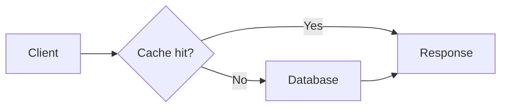
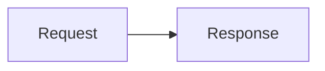
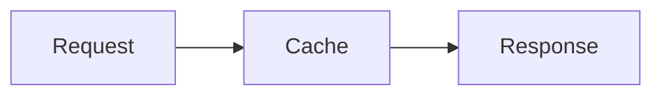
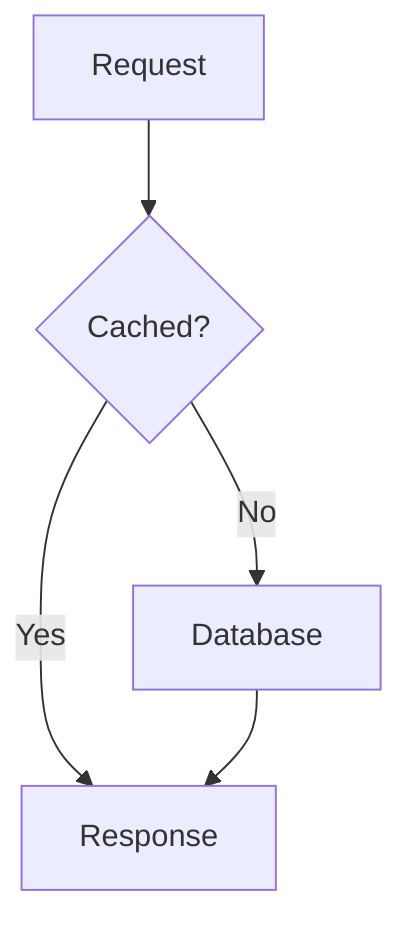

# Authoring interactive technical posts

Post content stays Markdown. Four fenced block languages render as interactive UI in both the editor preview and the public article: `chart`, `mermaid`, `scene`, and `illustration`. The editor's **Insert interactive block** button inserts complete examples. The initial workspace sample is a working technical article; new posts start blank.

AI agents can generate these blocks and save them using the existing CLI or posts API. This is a rendering and authoring format; it does not add an AI model or a prompt-to-content service to the editor. Ordinary code fences continue to display code. Raw HTML, JavaScript, JSX, and arbitrary component imports are not executed.

## Reference for LLM authors

Use the [LLM authoring guide](../cli/skills/margin-authoring/references/content.md) for a compact syntax contract and examples across all supported blocks and tags. Every engine serves that guide at `/authoring.md` and a generated schema/example catalog at `/authoring-blocks.json`. MCP clients can select `getAuthoringGuide` (`GET /api/public/authoring`) to retrieve both together before writing. The existing `margin-authoring` CLI skill includes the same files offline.

The catalog is generated from the actual renderer schemas and editor examples with `npm run generate:authoring`. `npm run check:authoring` (also part of `check:openapi` in CI) detects stale output. Cross-field and renderer constraints accompany the JSON Schemas as `rules`; schemas alone are not a complete validation or visual review.

## Charts

````md
```chart
{
  "title": "Latency under load",
  "description": "Compare the effect of caching.",
  "type": "line",
  "xLabel": "Concurrent requests",
  "yLabel": "Latency (ms)",
  "labels": ["10", "100", "500"],
  "series": [
    { "name": "Without cache", "values": [24, 78, 310], "color": "#b8794f" },
    { "name": "With cache", "values": [12, 21, 48], "color": "#537c68" }
  ]
}
```
````

`title`, `labels`, and `series` are required. `type` is `line` (default), `bar`, or `area`. Each series has a unique `name` and exactly one numeric value per label. Optional colors are six-digit hex values. Omit colors for the default palette. `description`, `xLabel`, and `yLabel` are optional. Labels are evenly spaced categories; they are not interpreted as numeric X coordinates. Negative values are supported, with a shared zero baseline. Readers can toggle series, change chart style, inspect values with a mouse or touch, and open an accessible table containing all data. Reader interactions do not change saved post content.

Limits: 8 series, 200 labels, finite values between -1e12 and 1e12. At least one series stays visible.

## Diagrams

````md

````

Use Mermaid syntax for flowcharts, sequence diagrams, state diagrams, and other supported diagram types. Readers can zoom and scroll larger diagrams. Use `accTitle` and `accDescr` in diagrams that support them to add accessible descriptions. Diagram configuration directives and YAML frontmatter are rejected: the renderer owns security configuration. Click callbacks and executable HTML are disabled by [Mermaid strict mode](https://mermaid.js.org/config/usage). Diagrams are limited to 300 edges.

## 3D scenes

````md
```scene
{
  "title": "A spatial model",
  "description": "Orbit around the model and inspect its geometry.",
  "background": "#f5f7f4",
  "autoRotate": false,
  "objects": [
    { "shape": "box", "label": "Compute", "position": [-2, 0, 0], "color": "#648774" },
    { "shape": "torus", "label": "Queue", "rotation": [0, 0.5, 0], "color": "#b8794f" },
    { "shape": "sphere", "label": "Storage", "position": [2, 0, 0], "scale": 0.8 }
  ]
}
```
````

`title` and `objects` are required. Each object needs `shape` and `label`. Shapes: `box`, `sphere`, `torus`, `cone`, and `cylinder`. Optional `position` and `rotation` are `[x, y, z]` triples, defaulting to `[0, 0, 0]`; rotations use radians. `scale` defaults to 1 (range 0.1–10). Coordinates and rotation values range from -50 to 50. `color` defaults to `#648774`. Background defaults to `#f5f7f4`. Up to 40 objects are supported. Imported geometry, embedded animation clips and illustrative pulse motion are also supported; see the model section below.

Scenes use Three.js and [OrbitControls](https://threejs.org/docs/pages/OrbitControls.html). Readers can drag to orbit, scroll or pinch to zoom, select an object on the canvas or using its labeled button, toggle wireframe, and reset the view. Focus the canvas and use arrow keys to orbit or +/− to zoom. Auto-rotation defaults off and respects reduced-motion preferences on load. Animation pauses off screen or in a hidden tab. Geometry and GPU resources are disposed when a block is removed. Browsers without WebGL show a fallback message and retain the description, object list, and source.

## Widget size and side-by-side layouts

The **Insert interactive block** picker includes width, visual height, and alignment controls. Select the size, then a widget type. **Two widgets side by side** inserts a chart and 3D scene in equal columns; replace either block with any supported widget. The selected height applies to both visuals. Each fills its column, regardless of the standalone width setting.

For an existing widget, wrap its code fence in a `widget` directive. Width options are `full`, `two-thirds`, `half`, and `third`; alignment is `left`, `center` (default), or `right`. Optional `height` is a whole number from 200 to 800 pixels, controlling the visual area only. Titles, controls, descriptions, and source remain outside that height. Omit it for automatic sizing.

````md
:::widget{width="half" height="320" align="center"}

:::
````

Group two or three widgets using `widgets`. The outer four-colon fence can contain three-colon `widget` wrappers:

`````md
::::widgets{columns="2"}

:::widget{height="320"}
```chart
{"title":"Illustrative throughput","labels":["Before","After"],"series":[{"name":"Requests/s","values":[100,240]}]}
```
:::

:::widget{height="320"}
```scene
{"title":"Compute node","objects":[{"shape":"box","label":"Server"}]}
```
:::

::::
`````

Use `columns="3"` for three equal columns. Each direct child is a grid cell; wrap each widget separately when specifying a height. At content widths of 640px or less, columns stack and fractional-width widgets become full-width. This responds to the article or editor preview width, not just the browser window. Readers' zoom and other interactions work within each widget independently. Layout is preserved by the normal Markdown save, publish, and CLI workflows.

### Text beside widgets, images, or video

To let the **article itself flow around a smaller visual**, enable **Wrap article text beside this widget** in the picker. It selects a half-width, left-aligned widget by default. You can switch to right alignment or another fractional width. Write your paragraphs immediately after the widget wrapper:

````md
:::widget{width="half" height="240" align="left" wrap="true"}

:::

Your article continues here, in the space to the right of the diagram. More paragraphs follow the same flow. Once the text passes the bottom of the visual, it uses the full article width again.

The same wrapper works around an image or video directive instead of a code fence.

::clear

## A new full-width section

Use the optional clear directive when the next section must start below the visual.
````

Use `align="right"` to put the visual on the right with prose on the left. Full-width and center-aligned widgets do not float. On narrow screens, wrapping switches off and prose follows the full-width visual. Width and height describe the visual; the text remains ordinary article content.

For explicit columns where each side stays separate, use the layout below.

Use **Text beside a visual** in the widget picker to insert an editable explanation next to an interactive chart. Each `column` can contain normal Markdown: multiple paragraphs, headings, lists, callouts, code, media directives, and widgets. Swap the chart for a `scene` or `mermaid` fence, or insert media into that column with the existing media picker.

`````md
::::columns{columns="2" ratio="wide-right"}

:::column
## Follow the request

The cache avoids a database lookup when the response is already available.

- **Hit:** return immediately.
- **Miss:** fetch and cache the result.
:::

:::column

:::

::::
`````

For media, replace the Mermaid code fence above with `::image{src="https://example.com/image.jpg" alt="Describe the image"}` or `::video{src="https://example.com/video.mp4" caption="Describe the video"}` using your own media URL. The existing frame, caption, and width attributes still work. The `ratio` can be `equal` (default), `wide-left` (2:1), or `wide-right` (1:2). `columns="3"` always uses equal thirds. Text and media stack in document order at narrow widths. When nesting a sized `widget` wrapper inside a `column`, use five colons for the outer `columns`, four for each `column`, and three for the `widget`; the picker generates this for you.

## Generation contract

Give an AI author this instruction together with the examples above:

> Write a technical article in Markdown. Use fenced `chart` JSON for quantitative comparisons, fenced `mermaid` for systems and processes, and fenced `scene` JSON for interactive geometry. Follow the exact documented schemas, include meaningful titles and descriptions, and explain each visual in surrounding prose. Never invent measurements: label illustrative data as illustrative. Do not output executable JavaScript, JSX, HTML, Mermaid configuration, or undocumented properties. Return the complete Markdown article.

Save the resulting `.md` file using `npm run cli -- create --title 'Article title' --slug article-title --file article.md`. Review the draft before publishing. Both API and CLI preserve these blocks as part of the same revisioned Markdown body; no database migration or new storage service is needed.

All blocks are capped at 50,000 characters. Invalid JSON or schema violations show a local error with the source still available; the rest of the article keeps rendering. 3D and diagram libraries load only when those blocks approach the viewport. New block kinds can be added through the language registry, parser, and component dispatch in `src/blocks`.

## Image carousels

Choose **Insert media → Image carousel** to add 2–20 images from URLs or the connected Cloudinary library. Each image has its own screen-reader description and optional visible caption. Reorder the images with the up/down buttons and check the live preview before inserting. Upload new assets through the existing Cloudinary library tab, then select them in the carousel.

```md
:::carousel{title="From sketch to system" fit="contain"}
::image{src="https://example.com/sketch.png" alt="Initial system sketch" caption="Start with the main components." frame="plain"}

::image{src="https://example.com/architecture.png" alt="Final system architecture" caption="The complete request flow." frame="plain"}

::image{src="https://example.com/results.png" alt="Latency comparison chart" caption="Measured results." frame="plain"}
:::
```

Readers see part of the next slide and can use arrows, touch swipes, mouse dragging, or horizontal trackpad scrolling. The scrollbar stays hidden. Focus the gallery and use Left/Right, Home, or End to navigate by keyboard. There is no autoplay; navigation respects reduced-motion preferences.

`fit="contain"` shows each complete image and is the default for technical screenshots and diagrams. `fit="cover"` fills the slide and crops edges. The carousel accepts direct `::image` children, up to 20. It works in both editor and public article views and can sit inside a `widget` wrapper for width, height, alignment, and text wrapping (use four colons for the outer widget around the three-colon carousel).

## Horizontal and vertical content tabs

Choose **Insert interactive block → Horizontal tabs / Vertical tabs**, or type `/tabs` or `/vertical` on a new line in the editor. Edit panel titles and content directly in Markdown. `[Tabs` and `[Tab` also offer autocomplete, including orientation and title properties.

````md
[Tabs orientation="horizontal" title="Installation options"]
[Tab title="Docker"]
### Run with Docker

Use **Docker Compose** to start the app and its storage.

```sh
docker compose up -d
```
[/Tab]

[Tab title="Local development"]
### Run locally

Install dependencies, configure your environment, and start the development server.
[/Tab]
[/Tabs]
````

Set `orientation="vertical"` to place the tab labels down the left side. The default is `horizontal`. The group’s `title` is its accessible name; each `Tab` uses its own `title` as its button label. Put opening and closing tags on separate lines. Tabs can contain Markdown, images, videos, other tab groups, and the supported interactive blocks. Each group keeps its selection independent, both in live preview and on published articles.

Use Left/Right for horizontal tabs, Up/Down for vertical tabs, and Home/End to move to the first/last tab. Selection follows keyboard focus. Only the active panel is mounted, so hidden videos stop playing and charts render at the visible size; returning to a tab resets its interactive state. In RSS, every panel appears in reading order under its label so subscribers receive all the content.

### Customize tabs

Use **Insert tabs** in the editor toolbar for the tab builder. It includes a live preview, editable panel labels and Markdown content, add/remove/reorder buttons, and these settings:

| Property | Values | Default |
| --- | --- | --- |
| `orientation` | `horizontal`, `vertical` | `horizontal` |
| `variant` | `underline`, `pills`, `boxed` | `underline` |
| `spacing` | `comfortable`, `compact` | `comfortable` |
| `initial` | Initially selected tab, numbered from 1 | `1` |
| `accent` | Six-digit hex color, such as `#3b5ccc` | Charcoal |
| `radius` | Corner radius from 0 to 24 pixels | Blog theme radius |
| `title` | Accessible group name | `Tabbed content` |

For example: `[Tabs orientation="vertical" variant="pills" spacing="compact" initial="2" accent="#3b5ccc" radius="12" title="Installation"]`. Keep the same `[Tab title="…"]` panels and closing tags below it. The settings remain editable in Markdown after insertion, and property autocomplete suggests supported values. The builder supports up to 12 panels; hand-authored groups can contain more. An initial tab beyond the group’s panel count selects the final panel. Pill text automatically switches between dark and light for contrast with your accent.

## Clickable illustrations

Use **Insert interactive block → Clickable illustration**, `/illustration`, or an
`[Illustration]` tag to explain a vector drawing with numbered regions. An
`illustration` JSON fence is equivalent. Readers select a marker, click an
associated shape, or choose its labelled button to read a description. Zoom,
reset, previous/next, an expanded modal view, and a full description transcript
are included. Escape closes the expanded view and returns focus to its trigger.

```text
[Illustration]
{
  "title": "Explore a cross-section",
  "description": "Select a number to learn about a layer.",
  "width": 400,
  "height": 300,
  "shapes": [
    {"path": "M80 60 H320 V240 H80 Z", "fill": "#b66c60", "region": "outer"},
    {"path": "M140 110 H260 V190 H140 Z", "fill": "#ebc5ab", "region": "inner"}
  ],
  "regions": [
    {"id": "outer", "label": "Outer layer", "description": "Surrounds the core.", "x": 105, "y": 85},
    {"id": "inner", "label": "Inner core", "description": "Inside the outer layer.", "x": 200, "y": 150}
  ]
}
[/Illustration]
```

`title` and `regions` are required. Supply vector shapes, exported artwork, or both. Dimensions default to 600 × 600 and
must be integers from 100 to 1000. Marker coordinates use those dimensions and
must fall inside the drawing. Background defaults to `#faf5ed`. Shapes use SVG
path geometry and six-digit hex fills; optional `stroke` is a hex colour and
`strokeWidth` ranges from 0 to 20 (default 2). Optional `region` references an
existing region ID. Regions require unique IDs, labels, descriptions and x/y
coordinates; their marker `color` defaults to `#a64040`. Source order controls
painting order and previous/next navigation.

Limits: 100 shapes, 30 regions, 8,000 characters per path, 160 per title/label/ID,
2,000 per description, and 50,000 per complete block. No arbitrary SVG markup,
HTML, JavaScript, CSS or external assets are executed. Invalid content shows the
normal block error. The usual width/height/alignment wrappers work here too.
RSS and server-rendered article HTML include the text of every region. The block
is a schematic drawing, not a 3D model or a physiological simulation.

For a complete scientific example and the capability assessment, see
[the heart atlas review](heart-atlas-capability-review.md) and
[the example article](../examples/heart-atlas/article.md).

### Animated flow journeys

Illustrations can optionally include a `flow` object. This adds a paused-by-default
journey with Play/Pause, Restart, 0.5×/1×/2× speed, direct stage selection, and
previous/next controls. Inline and expanded views share one playback clock and
position. Existing illustrations without `flow` are unchanged.

```json
{
  "title": "A two-stage journey",
  "description": "Illustrative movement, not measured speed.",
  "secondsPerStep": 4,
  "landmarks": [{"label": "Destination", "x": 300, "y": 180}],
  "steps": [
    {"label": "Arrive", "description": "Enter the outer layer.", "points": [[80,85],[105,85]], "color": "#315e9b", "region": "outer"},
    {"label": "Continue", "description": "Travel to the core.", "points": [[105,85],[200,150]], "color": "#315e9b", "endColor": "#b33f36", "region": "inner"}
  ]
}
```

Place this object in the illustration's `flow` property, alongside its shapes and
regions. Coordinates share the drawing's coordinate system. Each step needs a
label, description, colour, and 2–40 distinct consecutive points. Adjacent steps
must meet exactly. A step may highlight an existing `region` and blend to an
`endColor`; colour changes should have an explanation. The moving marker follows
polyline distance, with a directional arrow visible when paused. Optional
`landmarks` (up to 10, labels up to 40 characters) identify external destinations.

Limits: 1–30 stages, 2–12 seconds per stage (default 4), all points and landmarks
inside the drawing. All prior text, colour and total source limits still apply.
Playback stops at the final endpoint; Replay starts again. Selecting a stage or
an anatomical structure pauses playback. Hidden tabs and offscreen blocks pause;
returning requires Play. Reduced-motion users receive static route arrows and
manual steps instead of animated playback. The complete ordered journey appears
in a transcript, RSS and server-rendered HTML.

### Writer’s Pad diagram tags

Type `/model` or `/figma` on a new line, or use bracket-tag autocomplete. The picker inserts the same one-line tags. Use the URL returned by an upload or a real asset/share URL in place of the examples.

```text
[Model src="/assets/assembly.glb" title="Assembly" clip="/assets/lift.json"]
[Figma url="https://www.figma.com/design/FILEKEY" title="Assembly drawing"]
```

`clip` is optional. Embedded GLB/glTF clips are available automatically. Both tags accept `width`, `height`, `align` and `wrap`. Put each tag on its own line. Double-click the folded label to edit its source. Use `[Scene]` for multiple objects and `[Illustration]` for artwork with clickable regions.

Drop a model onto the pad to upload it at the writing cursor. To attach a separate Three.js transform animation, drop one model and one JSON clip together, in either order.

### Copyable 3D animations

In the writing assistant, ask for a 3D animation and describe what should move. Use **Preview animation** to inspect the result and **Copy animation** to copy its complete scene tag. Paste it into the Writer’s Pad on its own line. The source remains editable after insertion.

Scene objects accept 1–32 `keyframes`. Each frame specifies `time` in seconds and a position or rotation triple. Times increase from above zero to at most 120 seconds. Each track starts at the object’s authored pose, interpolates linearly and holds its last value until the scene loops. All objects share the same animation clock. Rotations use radians and can describe full turns. Built-in shapes and keyframes require no external model or clip files.

### Imported 3D models and illustrative pulse

`scene` blocks now accept `shape: "model"` with a GLB, self-contained glTF, OBJ or STL
`src`. Sources can be HTTPS URLs or paths starting with a single `/`. The example
preview serves its original model at `/assets/heart.glb`:

```json
{
  "title": "A beating heart in 3D",
  "description": "Original schematic geometry; exaggerated motion for teaching.",
  "objects": [{
    "shape": "model",
    "label": "Heart",
    "src": "/assets/heart.glb",
    "pulse": {"bpm": 72, "amplitude": 0.09}
  }]
}
```

The model is centred and fitted to a 2.6-unit maximum dimension before applying
the normal object position, rotation and scale. Authored material colours are
preserved; `color` still controls the legend swatch. Readers orbit, zoom, select,
and inspect wireframe as with procedural shapes. Loading and failure messages
retain the article and controls. Model downloads are aborted on unmount; geometry,
materials, textures, controls and WebGL resources are released.

In **Insert interactive block → Import a diagram**, choose **3D model or animation**, choose **Upload model** and select a file from your computer. The picker fills in its Margin URL and suggests a title. You can also paste an existing asset URL. Select **Insert diagram** to add it to the post. GLB and glTF 2.0 carry materials and animation clips. Readers choose a clip and press Play. Pause retains its position. Switching clips starts the selected clip at its first frame. To export animations from Three.js, pass your clips explicitly:

```js
const glb = await new GLTFExporter().parseAsync(scene, {
  binary: true,
  animations: clips,
});
```

Save the returned bytes as a `.glb` file and upload it. If you already have a standalone Three.js transform clip, save `JSON.stringify(clip.toJSON())` as a `.json` file and select it under **Upload Three.js clip** alongside the model. In Markdown, set the model object's `animationSrc`. Position, scale, quaternion and individual Euler rotation components can target the root or a named node. Node names must match the imported model. For morph animation, use embedded glTF clips.

For JSON glTF, export a single file with base64 buffers and embedded images. Use standard glTF without required extensions. OBJ imports geometry without material-library sidecars. STL supports ASCII and binary triangle meshes. The 20 MiB limit applies per file. glTF has a 1,000-node and two-million-accessor-element limit.

Margin stores uploads in the publication’s configured storage. Draft files are available to authorized editors and scoped draft previews. A published post referencing a file makes it available to readers. When the last published reference is removed, the file becomes private again.

Same-origin model URLs work by default. For a separate asset host, enable CORS there and add its HTTPS origin to the server’s space-separated `MARGIN_MODEL_ORIGINS` setting. Cloudinary’s `res.cloudinary.com` is included. External model downloads omit credentials and reject redirects. Margin uses the current session for its own private uploads.

Optional `pulse` works on a model or procedural object. `bpm` defaults to 72 and
ranges from 30–180; `amplitude` defaults to 0.07 and ranges from 0.01–0.15. It
compresses the object on two axes and slightly stretches the third with an
illustrative repeating waveform. Pulse starts on for an explicitly authored pulse,
can be paused/resumed, freezes offscreen or in a hidden tab, and is disabled by
reduced-motion preferences. It does not deform individual chambers, model valve
motion, or simulate pressures or a medically accurate cardiac cycle. A selected
anatomical rate is a presentation parameter, not a diagnosis or measurement.

### Figma diagrams

In **Import a diagram**, choose **Live Figma design or prototype** and paste the share link. Readers can load it in the article or open the original. Figma applies the file’s sharing permissions. The original link is also available in static exports.

Choose **Illustration from exported artwork** for a hosted SVG, PNG or JPEG exported from Figma. Edit the inserted region labels, descriptions and coordinates. Set the illustration width and height to match the frame’s aspect ratio. The artwork fits within that coordinate system, beneath the numbered markers, in both inline and expanded views.

### Static posters for scenes and illustrations

Both JSON blocks accept an optional still image:

```json
"poster": {
  "src": "/assets/heart-poster.jpg",
  "alt": "Static front view of the schematic heart."
}
```

Use an HTTPS or root-relative image URL and non-empty alternative text (up to
2,000 characters). Posters are authored assets, not generated by Margin. RSS,
readable HTML and print include the poster with its text caption. Scenes also
export their title, description and object labels; illustrations retain numbered
region explanations and the full ordered flow transcript. The scene uses its
poster if WebGL or model loading fails. Posters are optional, so text remains
available when a still has not been supplied or a reader blocks images.

Markdown downloads preserve the original Margin tags/JSON. They do not bundle
image/model files or translate the article into portable static Markdown. PDF
saving uses the browser print dialog, with static images and text in place of
interactive graphics. Margin does not currently produce server-side PDFs.

### Explain selected 3D objects

A scene object's optional `description` (up to 2,000 characters) appears below the
scene when that object is selected, either on the model or through its labelled
button. This is plain text, not executable markup. RSS, readable HTML and print
include every object label and description without requiring selection.

`examples/car-atlas` demonstrates an assembled GLB, six separately selectable
GLB assemblies in an exploded view, and a power-flow illustration, alongside the
heart article in the same local preview. Exploded positions are ordinary authored
object positions; there is no car-specific runtime or automatic explode animation.

## Interactive checklists

Choose **Insert interactive block → Interactive checklist**, or type `/checklist`.
The **Float while reading** option is off by default. Turn it on to offer a
collapsible checklist panel in the corner of published articles and guides.

```md
[Checklist title="Dinner checklist" floating="true"]
- [ ] Gather the ingredients
- [ ] Prepare the vegetables
- [ ] Cook, taste, and serve
[/Checklist]
```

Readers can tick or untick tasks in the article or in the floating panel; both
views share the same state. Open the panel while scrolling, minimize it when it
is in the way, and use **Reset checklist** to restore the author's starting
checks. When a page has multiple floating checklists, the panel offers a selector.
It is collapsed initially, has its own scrolling area, and fits narrow screens.
Escape minimizes the panel and returns focus to its toggle.

Omit `floating`, or set `floating="false"`, for an interactive checklist that stays
in the article. Ordinary Markdown task lists outside `[Checklist]` remain
read-only. `title` is plain text (up to 160 characters); rich Markdown labels stay
formatted inline and appear as plain text in the floating panel. Nested task
items are supported. `:::checklist{title="Dinner checklist" floating="true"}` is
an equivalent Markdown directive.

Ticks are reader-local, in-memory state. They do not edit or save the post, sync
between readers, or survive reloads, content changes, or a checklist being removed
from an active tab. No task-completion values are submitted to analytics. Existing
page views, reading time, and ordinary control-click collection continue. Editor
and designer previews allow inline ticking but do not float outside their preview.
Print, readable HTML, and RSS retain the author's original checklist and omit the
floating panel. Markdown export retains the original tags and task states.
