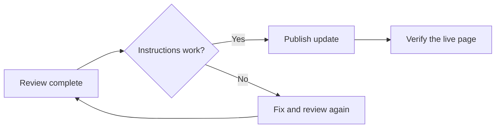

> **Outcome:** publish a clear, tested product update with one owner and a visible recovery plan.

## When to use this playbook

Use this process when a product change is ready for customers: a new feature, an important improvement, or a change to an existing workflow. This is a sample team process, ready to adapt to your own release cadence.

**Release owner:** coordinates the handoff. **Reviewer:** checks accuracy. **Support lead:** confirms that the explanation answers likely customer questions.

## Before you begin

- [ ] The change is available in the environment readers will use.
- [ ] One person owns the final publish decision.
- [ ] Screenshots and instructions match the released interface.
- [ ] A recovery contact is named if the release needs to pause.

## 1. Write the reader's outcome

Start with what someone can now do. Follow with the shortest path to trying it.

| Include | Example |
| --- | --- |
| What changed | Guides now have their own design settings. |
| Who benefits | Teams publishing manuals and playbooks. |
| First action | Open **New → Guide** and choose an outline. |
| Success check | Preview shows the correct guide layout. |

Keep internal ticket numbers and implementation details in the team's release notes unless they help the reader act.

## 2. Run a fresh-reader check

Ask the reviewer to follow the instructions from the beginning. They should use the published feature, not their memory of how it works.

1. Open every destination link.
2. Follow each instruction in order.
3. Check the page on a narrow screen.
4. Confirm the final result matches the promise in the opening paragraph.

## 3. Make the publish decision

**Pause** if the feature is unavailable, the instructions fail, or the audience is unclear. Record the blocker and the person responsible for resolving it.

## 4. Verify and hand over

Open the live URL in a signed-out browser. Check the title, navigation, links, and downloadable Markdown. Share the final URL with the support lead through your team's normal workflow.

Publishing in Margin does not automatically send an email campaign. Treat any announcement as a separate, deliberate step.

## Completion checks

- [ ] The live page is readable without signing in.
- [ ] The instructions have been independently followed.
- [ ] Support has the final link and a named owner.
- [ ] Any follow-up corrections are recorded.

**If something goes wrong:** unpublish the affected page, correct the draft, repeat the failed check, and publish again when it is ready.
